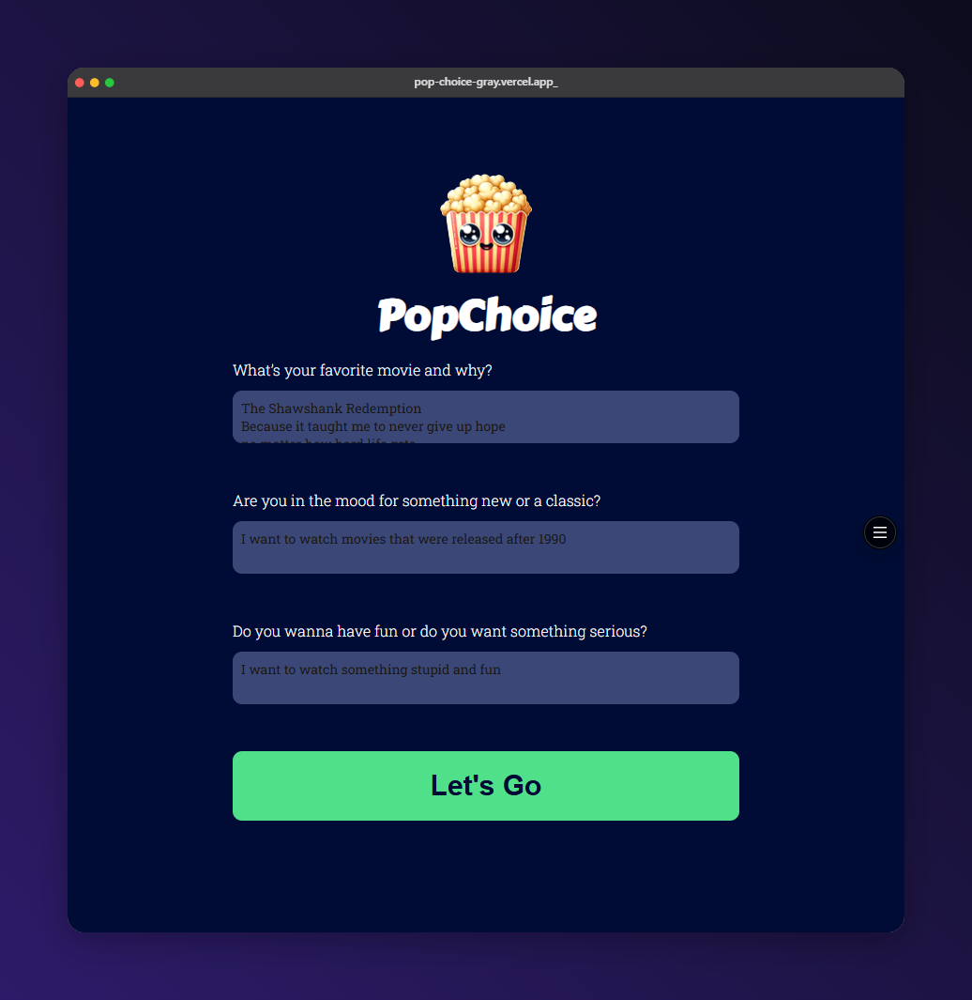

# 🍿 PopChoice

PopChoice is an AI movie recommender. You answer three short questions about your taste, and it suggests one film with a short explanation of why it fits you.

**Live demo:** (https://pop-choice-gray.vercel.app/)



## How it works

1. You answer three questions:
   - What is your favorite movie and why?
   - Do you want something new or a classic?
   - Do you want to have fun or watch something serious?
2. The answers are combined into one text and turned into an **embedding** with OpenAI.
3. That embedding is compared against the film embeddings stored in **Supabase** (pgvector) to find the closest matches.
4. The matched films and your answers are sent to a **chat model**, which picks the best film and explains why.
5. The result is sanitized with DOMPurify and shown on the page.

```
Browser (HTML/CSS/JS)
   │  POST /api/search
   ▼
Vercel serverless function
   ├─ OpenAI embeddings  → vector for the user's answers
   ├─ Supabase pgvector  → closest films (match_documents)
   └─ OpenAI chat model  → recommendation as HTML
```

The API keys stay on the server. The browser only calls `/api/search`.

## Tech stack

- HTML, CSS and vanilla JavaScript (no framework, no build step)
- Vercel serverless functions (`api/` folder)
- OpenAI API: `text-embedding-3-small` for embeddings and a chat model for the recommendation
- Supabase with the `pgvector` extension
- DOMPurify to sanitize the AI's HTML before rendering

## Project structure

```
popChoice/
├── api/
│   ├── _openai.js        # OpenAI client
│   ├── _supabase.js      # Supabase client
│   └── search.js         # POST /api/search: the whole pipeline
├── lib/
│   ├── embed.js          # creates embeddings in batches
│   ├── findMatch.js      # calls match_documents in Supabase
│   └── getChatCompletions.js  # system prompt + chat call
├── data/
│   └── films.js          # the films that get embedded
├── scripts/
│   └── ingest.js         # embeds films.js and stores them in Supabase
├── index.html
├── index.js
├── style.css
└── vercel.json
```

Files that start with `_` inside `api/` are not exposed as routes.

## Getting started

### 1. Install

```bash
npm install
```

### 2. Set up Supabase

In the SQL Editor, create the table and the search function:

```sql
create extension if not exists vector;

create table documents (
  id bigint generated always as identity primary key,
  content text not null,
  metadata jsonb default '{}',
  embedding vector(1536)
);

alter table documents enable row level security;

create index on documents using hnsw (embedding vector_cosine_ops);

create or replace function match_documents (
  query_embedding vector(1536),
  match_count int default 5,
  match_threshold float default 0.3
)
returns table (id bigint, content text, metadata jsonb, similarity float)
language sql stable
as $$
  select id, content, metadata,
         1 - (embedding <=> query_embedding) as similarity
  from documents
  where 1 - (embedding <=> query_embedding) > match_threshold
  order by embedding <=> query_embedding
  limit match_count;
$$;
```

Keep only one `match_documents` function in the database. Two versions with the same parameters in a different order cause a `PGRST203` error.

### 3. Environment variables

Create a `.env.local` file in the project root:

```
AI_KEY=your_openai_api_key
SUPABASE_URL=your_supabase_project_url
SUPABASE_SERVICE_ROLE_KEY=your_supabase_service_role_key
AI_MODEL_CHAT=gpt-4.1-mini
```

Never commit this file or expose the service role key in browser code. Add the same four variables in your Vercel project settings for deployment.

### 4. Add the films to the database

```bash
node --env-file=.env.local scripts/ingest.js
```

Run it again whenever you change `data/films.js`.

### 5. Run locally

```bash
npm i -g vercel
vercel dev
```

Open the address it prints (usually `http://localhost:3000`). A plain static server such as Live Server will not run the `api/` functions.

## Deployment

1. Push the project to GitHub (make sure `.env.local` and `.vercel` are in `.gitignore`).
2. Import the repository in Vercel, or run `vercel --prod`.
3. Add `AI_KEY`, `SUPABASE_URL`, `SUPABASE_SERVICE_ROLE_KEY` and `AI_MODEL_CHAT` under **Project Settings → Environment Variables**.
4. Redeploy so the variables are loaded.

## Things I learned

- Calling OpenAI and Supabase from a serverless function so the keys never reach the browser
- Embeddings and vector similarity search with pgvector
- Prompt design: giving the model a strict output format and a fallback when nothing fits
- Sanitizing AI-generated HTML before putting it on the page
- Debugging environment variables between local development and Vercel

## Possible improvements

- Add many more films to the database
- Filter by release year or genre in SQL before ranking
- Show the matched films with their similarity score
- Rate limiting on `/api/search` to protect API credit

## License

For learning and portfolio purposes.
